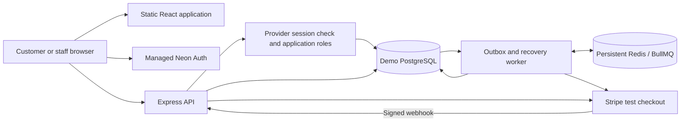

# Docklane architecture

Docklane is a TypeScript modular monolith with three deployed processes: React web, Express API, and a recovery worker. Shared domain code owns stock and order transitions. PostgreSQL owns the authoritative state; Redis delivers jobs and can be rebuilt from durable work.

## Stock correctness

Available stock is `on_hand - reserved`. Database checks enforce nonnegative values and `reserved <= on_hand`. Checkout normalizes SKU lines, selects one eligible warehouse, locks relevant balances in stable order, and rechecks stock in one transaction. It commits every line, reservations, movements, order snapshots, and the idempotency outcome together. A failed line rolls everything back.

Payment keeps stock allocated until shipment. Shipment subtracts physical and reserved quantities together. Expiry and eligible cancellation release holds once. Receiving and restocking a return changes stock explicitly; refunding money alone does not. Balance versions and movement records make changes explainable.

The [concurrency proof](CONCURRENCY_PROOF.md) uses ten units and fifty simultaneous requests: ten reservations succeed and forty receive insufficient-stock results. This proves that scenario; it is not a throughput or production load claim.

## Identity and authorization

Managed Neon Auth owns identities, recovery, and sessions. The API checks the provider JWT and an active provider session, then loads application-owned role, active status, business membership, and customer ownership. Browser-supplied roles are never authoritative. Self-registration grants Customer access. Only an Admin can grant staff access or initiate the protected refund operations.

The demo has its own Neon branch and provider configuration when provisioned. App traffic uses the pooled database URL; migrations use the direct connection. The release validator refuses development's known compute, mixed branch URLs, insecure public origins, and live Stripe keys.

## Payments and recovery

Stripe test Checkout sessions and refund requests run outside inventory locks with persisted operation records and stable provider idempotency keys. Signed webhooks are deduplicated. The browser return does not prove payment. Payment and expiry serialize against the same authoritative order state. A late capture creates compensation work rather than reviving expired stock.

Transactions write outbox records with their business change. The worker dispatches BullMQ jobs and performs database sweeps for overdue reservations, reconciliation, and recoverable work. Leases prevent simultaneous ownership; replacement processes can reclaim expired work. Redis loss can delay delivery, but PostgreSQL retains the recovery records. Provider ambiguity remains visible until reconciliation determines the outcome.

## Deployment tradeoffs

The prepared Render configuration uses one API process, one worker, persistent Redis with `noeviction`, and a static frontend. Vercel frontend configuration is also supplied. Singapore compute matches the existing Neon region. Provider selection, paid resources, and Blueprint application require review before launch; see [deployment preparation](DEPLOYMENT.md).

Rate limits are currently process-local: a second API replica needs a shared limiter. The first release supports one business and one warehouse per order. Carrier integration, split shipments, live payments, multi-currency, and tenancy are outside its scope. The worker's health endpoint checks database reachability and configured expiry processing; it is not a guarantee that Redis or Stripe is reachable.

## Repository boundaries

| Location             | Responsibility                                                                            |
| -------------------- | ----------------------------------------------------------------------------------------- |
| `apps/web`           | Responsive staff/customer UI, public page, explicit sample adapter, appearance and motion |
| `apps/api`           | HTTP validation, session/role checks, rate limits, safe errors, webhook ingress           |
| `apps/worker`        | Outbox delivery, queues, leases, scheduled reconciliation and expiry                      |
| `packages/contracts` | Shared schemas and response types                                                         |
| `packages/database`  | Prisma models, migrations, PostgreSQL adapters                                            |
| `packages/domain`    | Stock, checkout, payment, fulfillment, refund and return transitions                      |
| `scripts`            | Setup, proofs, benchmarks, guarded release and demo operations                            |

Verification distinguishes local database behavior, simulated provider transport, historical sandbox checks, and future hosted smoke checks. Dated evidence is in the phase notes; [Phase 9](PHASE_9.md) tracks remaining hosted work.
