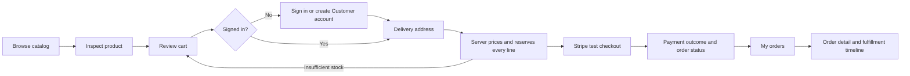

# Phase 1: Visual system and interactive prototype

Status: complete. Verified on 18 November 2026, Asia/Kolkata.

Docklane now has a runnable staff workspace built with React, TypeScript, Vite, Tailwind CSS v4, customized shadcn/Radix components, TanStack Table, Motion, Phosphor icons, Recharts, Sonner, and self-hosted Geist fonts.

## Delivered scope

| Surface      | Working behavior                                                                                                                              |
| ------------ | --------------------------------------------------------------------------------------------------------------------------------------------- |
| Workspace    | Seven navigation destinations, global command search, account/settings entry, workspace guide, mobile navigation                              |
| Overview     | Derived stock/order metrics, warehouse filter, fulfillment stages, sample weekly chart, attention links, recent orders, product ranking       |
| Inventory    | Combined product/SKU search and warehouse/category/status filters, sorting, pagination, selection, CSV export, stock details                  |
| Stock drawer | On-hand/reserved/available quantities, reasoned in-memory adjustments, threshold/history display, validation and success feedback             |
| Orders       | Customer/order search, warehouse and fulfillment filters, sorting, CSV export, deep-linked order details, simulated packing                   |
| Order drawer | Separate order/payment/fulfillment states, customer and address, line items, totals, warehouse allocation, timeline, persistent action footer |
| Warehouses   | Three sample sites with coherent balances, reserved quantities, leads, open orders, and inventory links                                       |
| Payments     | Clearly labeled sample pending/captured/refunded records with search, filters, derived totals, and order links                                |
| Activity     | Sample order and stock events, warehouse/type filters, adjustment entries, detail links                                                       |
| Settings     | Sample workspace profile, data-state previews, demo reset, five-step customer wireflow                                                        |

The visual system uses ink navigation, a mist workspace, lime primary actions, restrained elevation, readable numerals, product thumbnails, and a compact lane-inspired brand mark. Motion supports route changes, drawer entry, hover/press feedback, toasts, and loading states. Reduced-motion preferences preserve the same information and actions.

Fixtures represent eight products, three warehouses, 24 stock balances, and 16 orders. Reserved stock is derived from active sample order lines. Overview totals and warehouse totals use the same fixture state as their underlying lists.

## Run and explore

Requirements: Node.js 22.12 or newer and npm. Verified with Node.js 22.16.0 on Windows.

```sh
npm ci
npm run dev
```

The workspace opens at [localhost:5173](http://localhost:5173). Useful entry points:

- [Inventory](http://localhost:5173/inventory): combine search, warehouse, category, and stock status; sort and export the filtered dataset.
- [Order details](http://localhost:5173/orders?order=DL-2048): inspect the timeline and use **Mark packed** to try the sample action.
- [Settings](http://localhost:5173/settings): preview loading, empty, and unavailable states; explore the customer journey or reset the fixtures.

Press `Ctrl+K` or `Cmd+K` to search pages, orders/customers, and products. Filters and detail identifiers are stored in the URL. Escape closes dialogs and restores focus to the invoking control.

For a production preview, run `npm run build`, then `npm run preview`, and open [localhost:4173](http://localhost:4173). To specify the port explicitly, use `npm run preview --workspace @docklane/web -- --port 4173 --strictPort`.

## Customer and account wireflows

Settings includes an interactive **Browse → Cart → Delivery → Payment → Confirmation** preview. It describes the planned payment handoff and does not create an order or charge a card.

The complete customer flow for the later implementation is established as follows:



Account flows planned for Phase 2:

- Sign in or create a Customer account, then return to the intended cart/delivery step. Preserve cart intent and recheck authoritative price/availability on submission.
- Account recovery, reset, and session restoration return the user to an appropriate signed-in screen with clear loading and error feedback.
- **My orders → Order detail** shows only orders owned by the signed-in customer. Staff enter the operations workspace according to API-enforced Admin/Operator roles.
- Signing out clears private account views. Recoverable validation/network errors preserve useful form input.

These account routes and authoritative checkout behaviors are wireflows, not working identity or payment integrations in Phase 1.

## Verification evidence

| Check                   | Result                                                                                                                                              |
| ----------------------- | --------------------------------------------------------------------------------------------------------------------------------------------------- |
| TypeScript              | Passed, including the type check performed by the production build                                                                                  |
| ESLint                  | Passed                                                                                                                                              |
| Vite production build   | Passed without circular-chunk or bundle-size warnings                                                                                               |
| Playwright Chromium     | 12 tests passed against the final production preview, in 46.0 seconds                                                                               |
| Automated accessibility | Zero reported violations across all seven staff screens and the order drawer; signature screens/drawer also checked in the production browser suite |
| Responsive layouts      | All seven staff screens fit widths of 390, 768, 1366, and 1440 px without page overflow; tables scroll within their own regions                     |
| Keyboard and focus      | Command search, Escape dismissal, focus restoration, mobile navigation, and reduced-motion details passed browser checks                            |
| Workflow behavior       | Combined filters and reload, sorting/pagination/export, packing, protected stock adjustments/reset, and data-state recovery passed                  |
| Visual inspection       | Production overview, inventory, and order details inspected on desktop; overview and full-width order details inspected on mobile                   |

The production inspection caught a CSS optimization issue that removed a drawer's `translate: none` override. Centering utilities are now applied only to centered dialogs. Order/stock drawers and mobile navigation explicitly opt out, and browser tests assert their viewport geometry.

Routes are loaded on demand. Vendor chunks match package roots to keep scoped icon and floating-positioning packages out of the React runtime chunk. The largest generated JavaScript chunk is the overview/chart route, approximately 427 kB before gzip and 123 kB gzipped. This is a build measurement, not a measured page-load or performance score.

To reproduce the regular checks:

```sh
npm run typecheck
npm run lint
npm run build
npm run test:e2e
npm run check:a11y
```

Playwright starts or reuses the development server by default. Start `npm run dev` before the standalone accessibility scan. On a fresh machine, run `npx playwright install chromium` once.

To run the same browser tests against an already running production preview in PowerShell:

```powershell
$env:PLAYWRIGHT_BASE_URL = 'http://127.0.0.1:4173'
npm run test:e2e
Remove-Item Env:PLAYWRIGHT_BASE_URL
```

The override disables Playwright's automatic development-server startup. Automated checks cover Chromium and the listed workflows; cross-browser coverage and further assistive-technology testing remain future verification work.

## Preview images

These screenshots come from the final production build:

- [Desktop overview](previews/overview-desktop.png)
- [Desktop inventory](previews/inventory-desktop.png)
- [Desktop order details](previews/order-details-desktop.png)
- [Mobile overview](previews/overview-mobile.png)
- [Mobile order details](previews/order-details-mobile.png)

With the development server running, regenerate them using `npm run capture:preview`. For a production preview, use `node scripts/capture-preview.mjs http://127.0.0.1:4173`.

## Dependency review

`npm audit --omit=dev` reports **zero vulnerabilities**. The full audit reports **10 high-severity transitive development-tool findings**, all tracing to the picomatch repeated-extglob ReDoS advisory [GHSA-fc5q-39xc-vjpf](https://github.com/advisories/GHSA-fc5q-39xc-vjpf), through Vite/globbing and TypeScript ESLint dependencies.

The full audit is not clean. Its forced-fix suggestion downgrades Vite to a breaking older version; that downgrade was not applied. Review the advisory and available compatible upstream fixes when dependencies are updated. No runtime dependency finding was reported by the production dependency audit.

## Phase boundary and next work

Sample stock adjustments and packing affect only React memory and reset on reload or via **Reset sample data**. The sample profile does not authenticate a user or enforce server permissions. Payment records and refunds are display fixtures; there are no provider calls. Shipping and other unavailable lifecycle actions are disabled with an explanation.

No API, database, worker, cloud account, persisted business mutation, real payment, or real shipment was created. Phase 1 does not prove concurrent reservation correctness. The documented inventory invariants and 50-request/10-unit concurrency proof remain backend requirements for Phase 4.

Phase 2 will add the API and shared workspaces, identity, application roles, database schema/migrations/seeds, lifecycle transitions, validation, and foundational integration checks. Later phases will connect the current views to authoritative services and build the customer production screens and marketing page.
