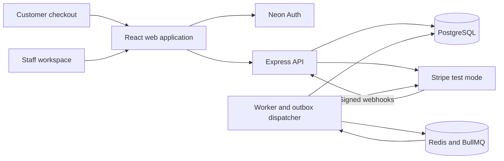

# Docklane build plan

Created: 18 November 2026, Asia/Kolkata.

Status: Phases 0-8 complete. Docklane is a verified release candidate. Phase 9 deployment, demo, and portfolio packaging remains planned.

## Product objective

Build a professional order and inventory platform with a memorable visual identity and a demonstrably correct inventory engine. Customers buy products through a small checkout flow. Staff manage stock, payment outcomes, and fulfillment from a responsive workspace.

The main proof is reproducible: with 10 available units and 50 simultaneous valid requests for one unit, exactly 10 reservations succeed and 40 receive an insufficient-stock result. There are no negative balances, partial orders, or unexplained inventory movements.

## First-release scope

| Area                | Included                                                                          |
| ------------------- | --------------------------------------------------------------------------------- |
| Business            | One business with multiple warehouses                                             |
| Users               | Admin, Operator, Customer                                                         |
| Catalog             | Products, SKUs, prices, product thumbnails, active/archive status                 |
| Inventory           | Warehouse balances, adjustments with reasons, thresholds, movement history        |
| Checkout            | Customer cart, delivery address, one warehouse per order, temporary reservations  |
| Orders              | Line-item and price snapshots, totals, customer history, staff views              |
| Payments            | Stripe test checkout, signed webhooks, retry-safe processing                      |
| Fulfillment         | Pack and manually record shipment/tracking details                                |
| Refunds and returns | Full/partial test refunds; explicit receipt and restocking of returned quantities |
| Operations          | Attention queue, stock views, order journey, warehouse overview, audit activity   |
| Delivery            | Deployed demo, automated correctness checks, documentation, screenshots           |

Use INR and integer paise amounts in version 1. Shipping is a fixed, server-defined charge or zero; complex tax calculations are deferred. Stripe test mode uses test credentials throughout.

Defer multi-business tenancy, warehouse transfers, split shipments, purchase orders, supplier integrations, barcode hardware, carrier integrations, multi-currency, production payment activation, forecasting, and AI features until the first release meets its completion checks.

## Working architecture

Use a TypeScript modular monolith: a React client, an Express API, and a worker sharing the same business services and PostgreSQL database. The worker is a separate process for asynchronous jobs, rather than a separate business service.



- React + Vite + TypeScript; Tailwind CSS v4; customized shadcn/ui built on Radix; Phosphor icons; Motion.
- TanStack Query for server state and TanStack Table for stock/order tables. Add global client state only where a real shared-state need appears.
- Express + TypeScript + Zod; structured logs; centralized error handling; versioned REST endpoints under `/api/v1`.
- PostgreSQL + Prisma for schema and ordinary queries. Use parameterized SQL inside transactions where row locking and atomic stock updates need explicit control.
- Neon Auth as the planned identity provider. Verify credentials on the API and load application roles and account status server-side. Use supported session validation for mutations; if JWT verification is used, account for token expiry and revocation semantics.
- Redis + BullMQ for job delivery; PostgreSQL outbox records preserve work when queue delivery or a process fails.
- Docker Compose for local PostgreSQL and Redis. Use dedicated test databases for integration tests.
- Planned hosting: Vercel for the web client, Render for API and worker, PostgreSQL on Neon, and a persistent Redis provider compatible with BullMQ. Confirm provider availability and cost before selecting paid plans during deployment.
- When using hosted Neon databases, develop on an isolated development branch; keep deployment/demo data separate from test data.

### Proposed repository layout

`apps/web`, `apps/api`, and the shared contracts, domain, and database packages are implemented. The worker will be introduced when asynchronous processing is added.

```text
apps/
  web/                 React application
  api/                 Express application
  worker/              Background processing
packages/
  contracts/           Shared request/response schemas and types
  database/            Prisma schema, migrations, seed data, transaction helpers
  domain/              Inventory, orders, payments, and fulfillment services
docs/
  DESIGN.md
  PROJECT_PLAN.md
```

The repository uses npm workspaces and includes a lockfile that pins resolved dependency versions. Use `npm ci` for reproducible installs.

## Data and correctness rules

### Core records

Application user profiles linked to identity subjects; products/SKUs; warehouses; inventory balances; inventory movements; orders; order items; stock reservations; payments; refunds; shipments; returns/return items; webhook receipts; idempotency records; outbox events; audit events.

Use database foreign keys and uniqueness constraints, including one inventory balance per warehouse/SKU and one recorded provider webhook per provider/event ID. Order item prices, product labels, currency, and delivery address are snapshots.

### Inventory invariants

1. `available = on_hand - reserved`.
2. `on_hand >= 0`, `reserved >= 0`, and `reserved <= on_hand`, enforced by database constraints.
3. Reserving adds to `reserved`; physical stock stays unchanged.
4. Payment converts a held reservation into an allocation; it remains in `reserved` until shipment or cancellation.
5. Shipment atomically decreases `on_hand` and `reserved` by the shipped quantity.
6. Expiry or eligible cancellation releases a reservation exactly once.
7. Refunds change money state. Explicitly received returns change stock.
8. Balance updates and their corresponding movement records commit together.
9. Stock corrections cannot reduce `on_hand` below `reserved`.
10. A multi-item checkout reserves every requested line or none.

### Lifecycle separation

| Record         | Planned states                                                          |
| -------------- | ----------------------------------------------------------------------- |
| Order          | Awaiting payment, confirmed, completed, cancelled, expired              |
| Reservation    | Held, allocated, consumed, released                                     |
| Payment        | Pending, captured, failed, refund pending, partially refunded, refunded |
| Fulfillment    | Unfulfilled, packed, shipped                                            |
| Refund attempt | Requested, processing, succeeded, failed, reconciliation required       |

Define a transition matrix before implementing these states. Payment, order, and fulfillment states are shown separately in the UI. A packed order can still be unshipped; a shipped order may later have a refund.

### Transaction boundaries

- Reservation: normalize duplicate SKU lines, validate positive quantities, choose one eligible warehouse, lock its relevant balance rows in stable SKU order, recheck availability, and atomically write the order, reservations, balances, movements, and idempotency outcome.
- Warehouse selection uses a deterministic priority and accepts only a warehouse that can fulfill every line. Revalidate inside the transaction; use bounded retries for contention/deadlocks and retry candidate selection when appropriate.
- Idempotency: scope checkout keys to the user and operation, store a request fingerprint, and reject reuse with a different payload. Concurrent same-key submissions must produce one order and the same result.
- External calls: create payment sessions and issue refunds outside database locks. Persist an operation with a stable provider idempotency key first, then reconcile its outcome.
- Webhooks: verify the signature using the raw body before parsing; validate provider amounts/currency/order association; deduplicate and apply state changes transactionally. Do not treat the browser success redirect as proof of payment.
- Expiry versus payment: serialize both on the same order and its reservations, use database time, and guard the current state. The initial reservation duration is 30 minutes, compatible with the planned hosted checkout flow; confirm current provider limits during integration.
- Late payment policy: confirmation processed after the reservation deadline does not revive the order. Release any held stock and create durable compensation work for an idempotent test refund. Expose refund-pending/refunded status to the customer. Test this even when the payment was captured before the webhook arrived.
- Job recovery: write outbox work in the same transaction as the business change; dispatch with retries and a periodic database sweep. Expiry still works after delayed jobs, process restarts, or temporary Redis failure.
- Refund capacity: account for successful and pending refunds atomically so concurrent requests cannot refund more than the captured amount. Reconcile ambiguous provider responses before releasing or reusing that capacity.

## Phase 0: Product and planning

Completed deliverables: project name, initial scope, visual direction, stack proposal, roadmap, and acceptance criteria in these documents.

The planning deliverables formed the basis of Phase 1. Backend infrastructure and authoritative business operations remain scheduled below.

## Phase 1: Visual system and interactive prototype

Status: complete. See [Phase 1 delivery notes](PHASE_1.md) for implemented scope, screenshots, verification, and limitations.

Purpose: establish Docklane's identity and exercise its most important staff interactions early.

Deliverables:

- Initialize the web workspace with React, TypeScript, Vite, Tailwind, component primitives, fonts, and icons.
- Define shared design tokens, buttons, inputs, badges, loading states, dialogs, and drawer behavior.
- Build responsive navigation and the operations overview, inventory view, and order-detail panel.
- Use realistic, explicitly identified fixtures with consistent stock, order, payment, and fulfillment states.
- Implement navigation, stock search, warehouse filtering, sorting, order selection, drawer dismissal, and the initial command menu.
- Add restrained motion and reduced-motion behavior.
- Establish catalog, cart, checkout, and account wireflows for later implementation.

Completion checks:

- The three signature views work at 390, 768, 1366, and 1440 px widths.
- Important actions are visible at 1366 x 768, and the page has no accidental horizontal overflow.
- Search/filter combinations and order selection work; Escape closes details; focus returns correctly.
- Loading, empty, error, and disabled states are represented.
- Brand controls and text pass contrast checks; motion has a reduced-motion equivalent.
- Type checking and a production build pass; browser inspection confirms the design and interactions.

Depends on: Phase 0. Output: a runnable UI prototype with no production inventory mutations.

## Phase 2: API, identity, and database foundation

Status: complete. See [Phase 2 delivery notes](PHASE_2.md) for implemented scope, commands, verification, and limitations.

Deliverables:

- Add API, database, contracts, and domain workspaces; stage worker entry points when jobs are introduced.
- Configure environments, local PostgreSQL/Redis, Prisma migrations, reproducible seeds, API health endpoints, and CI.
- Set up the development identity integration and implement sign-in, sign-out, account recovery, and session restoration.
- Implement Admin/Operator/Customer authorization using application-owned roles. Self-registration grants Customer only.
- Define lifecycle transitions and shared API validation/error shapes.
- Protect customer records by ownership and staff mutations by role.
- Seed a coherent demo business, warehouses, SKUs, and role-specific accounts without committing credentials.

Completion checks:

- A fresh database migrates and seeds reproducibly.
- Sessions restore after reload; protected endpoints reject missing/invalid identity.
- Customers cannot access another customer's orders; Operators cannot grant roles or issue Admin-only refunds.
- Validation, database errors, and unauthorized actions return consistent safe responses.
- CI runs formatting/linting, type checking, builds, and foundational API integration checks.

Depends on: Phase 1. Output: authenticated application with a real API and schema.

## Phase 3: Products, warehouses, and inventory

Status: complete. See [Phase 3 delivery notes](PHASE_3.md) for implementation, all 63 passing tests, restart/recovery checks, and reviewed previews.

Deliverables:

- Implement catalog/SKU and warehouse management with archive behavior for records referenced by orders.
- Implement stock balances, authorized adjustments with reasons, thresholds, and immutable movement history.
- Add an API-backed inventory view with server search, filtering, sorting, and pagination.
- Connect warehouse detail views and the accessible warehouse explorer.
- Implement customer catalog browsing and server-defined prices.

Completion checks:

- Every stock adjustment has a matching movement record and audit event.
- Invalid/negative quantities are rejected; corrections cannot consume reserved stock.
- List pagination and combined filters work with seeded datasets.
- Inventory persists across API restarts and matches movement history.

Depends on: Phase 2. Output: usable stock-management vertical slice.

## Phase 4: Reservations, orders, and concurrency proof

Status: complete. See [Phase 4 delivery notes](PHASE_4.md) for implementation, all 78 passing tests, the repeatable concurrency proof, and reviewed previews.

Deliverables:

- Implement the cart and server-priced order creation, address snapshots, warehouse selection, and all-or-nothing reservations.
- Add request idempotency and transactional stock locking/conditional updates.
- Implement customer order history and staff order views connected to the API.
- Record reservation deadlines using database time; prepare durable expiry work for Phase 5.
- Build a reproducible concurrent-request script and database-backed integration tests.

Completion checks:

- With 10 units, 50 concurrent distinct one-unit requests yield exactly 10 reservations and 40 insufficient-stock responses. Disable expiry during this specific test.
- Multi-item orders fail completely if any line lacks stock.
- Duplicate concurrent requests with one key create one order; a different payload with that key is rejected.
- Rollback after an injected failure leaves balances, reservations, orders, and movements consistent.
- Concurrent stock adjustments cannot invalidate reservations; repeated cancellations release stock once.

Depends on: Phase 3. Output: a proven inventory and order engine. Do not move to payments while these checks fail.

## Phase 5: Test payments and reservation expiry

Status: complete. Local correctness checks and hosted Stripe sandbox purchase/refund verification passed. See [Phase 5 delivery notes](PHASE_5.md) for setup, worker recovery, verification, and limitations.

Deliverables:

- Integrate Stripe test checkout and persist payment attempts with retry-safe provider keys.
- Implement raw-body signature verification, durable webhook receipts, event deduplication, and reconciliation.
- Add the worker, outbox dispatcher, BullMQ jobs, expiry sweeps, retry/backoff, and visible failed-job information.
- Implement payment-confirmation versus expiry serialization and late-payment compensation.
- Connect customer success, failure, expired, and refund-pending screens to authoritative API state.

Completion checks:

- Test checkout produces a confirmed order only after verified payment processing.
- Replayed or out-of-order webhooks do not duplicate allocation or regress completed states.
- The browser return URL cannot mark an unpaid order paid.
- Expiry releases stock exactly once, including after a worker restart or delayed job.
- Payment/expiry race tests preserve stock; late capture produces durable refund work and a correct customer status.
- A payment-session creation timeout can be retried without duplicate sessions or orders.

Depends on: Phase 4. Output: an end-to-end test purchase with recoverable asynchronous processing.

## Phase 6: Fulfillment, refunds, and returns

Status: complete. Packing, atomic shipment, paid cancellation, bounded Stripe test refunds, received returns, explicit restocking, and operational history are implemented. See [Phase 6 delivery notes](PHASE_6.md).

Deliverables:

- Add pack and ship actions with server-validated transitions, shipment references, and manual tracking details.
- Consume allocated inventory atomically on shipment.
- Implement eligible unshipped cancellation with stock release and payment compensation.
- Add Admin-only full/partial test refunds with durable attempts, provider idempotency, and reconciliation.
- Add received returns and explicit restocking, constrained by shipped quantities and previous returns.
- Connect the full order timeline and inventory history to operational events.

Completion checks:

- Repeated shipment commands consume stock once; unpaid, cancelled, or expired orders cannot ship.
- Refunds alone do not increase stock.
- Concurrent refunds cannot exceed the captured amount.
- Repeated return receipt/restock commands cannot exceed eligible returned quantities or double-count stock.
- Actions enforce roles and record actor, reason, quantities/amounts, and timestamps.

Depends on: Phase 5. Output: a complete order-to-fulfillment and refund lifecycle.

## Phase 7: Complete UX, operations views, and landing page

Status: complete. See [Phase 7 delivery notes](PHASE_7.md) for the connected briefing, explainable metrics, attention queues, saved views, role-scoped quick search, responsive checks, and product page.

Deliverables:

- Replace all prototype fixtures in operational views with API data; keep an explicit separate preview/demo adapter only if useful.
- Complete attention queues, inventory thresholds, order filters, saved views, quick search, and contextual actions.
- Define metric calculations and date/warehouse filters so dashboard totals are explainable.
- Complete responsive customer surfaces and staff workflows, including loading/error/recovery states.
- Add bounded query refresh and mutation invalidation so confirmed changes appear promptly without interrupting active input.
- Build the marketing page with actual product previews and the animated fulfillment narrative.
- Finish typography, spacing, motion, focus handling, and accessible warehouse exploration.

Completion checks:

- Every launch navigation destination works; filters and direct links preserve useful context.
- Metrics reconcile with underlying orders, payments, and inventory.
- Keyboard, touch, reduced-motion, and small-laptop flows are verified.
- Customer and staff workflows remain usable during loading and recoverable failures.
- The landing page accurately describes working features and leads to the demo.

Depends on: Phase 6. Output: a coherent, polished product experience.

## Phase 8: Correctness, security, and performance verification

Status: complete. See [Phase 8 delivery notes](PHASE_8.md) for 139 passing checks, request protection, failure recovery, representative query measurements, and production browser verification.

Deliverables:

- Complete database-backed regression tests for races, retries, expiry, refund limits, role checks, and customer ownership.
- Add Playwright coverage for core staff/customer workflows, avoiding tests that merely mirror component internals.
- Verify request validation, rate limits for sensitive endpoints, session handling, permitted origins, mutation protection, and secret configuration.
- Add appropriate database indexes, bound query sizes, inspect slow queries, and exercise a representative inventory/order dataset.
- Exercise worker failures, queue outages, webhook retries, process restarts, and reconciliation paths.
- Inspect contrast, focus, responsiveness, layout shifts, and performance with browser tooling.

Completion checks:

- Type checking, linting, builds, API/database tests, and core end-to-end tests pass in CI.
- The concurrency proof is reproducible with documented setup and results.
- Recovery checks produce consistent balances and explainable payment/job states.
- Query and browser measurements are documented with dataset, hardware/environment, and limitations; improvements respond to measured bottlenecks.
- No unresolved issue allows overselling, duplicate shipment, excessive refund, or unauthorized order access.

Depends on: Phase 7. Output: a release candidate with evidence supporting its reliability.

## Phase 9: Deployment, demo, and portfolio packaging

Deliverables:

- Deploy web, API, worker, PostgreSQL, and compatible persistent Redis with environment validation and health checks.
- Configure production/demo origins and test webhook URLs; verify actual account recovery and payment flows on deployed services.
- Establish separate development/demo databases and a restricted, repeatable demo reset process.
- Provide guided role-specific demo access; keep payment keys in test mode and identify demo information clearly.
- Document startup, migrations, seeds, workers, architecture, tradeoffs, recovery procedures, and measured concurrency results.
- Capture desktop/mobile screenshots and a short walkthrough; write resume bullets based on implemented and verified results.
- Verify a database backup/restore procedure in an isolated environment and record the result.

Completion checks:

- A visitor can open the landing page, use the demo, complete a test order, and inspect its fulfillment lifecycle.
- Sessions, inventory, and orders behave correctly after service restarts or hosting sleep.
- Signed webhooks reach the deployed API; the deployed worker processes expiry and refund work.
- Setup and verification instructions work from a fresh checkout.
- Live links, screenshots, architecture explanation, and actual validation evidence are ready to share.

Depends on: Phase 8. Output: the complete first release.

## Verification map

| Risk                            | Required evidence                                         | Introduced     |
| ------------------------------- | --------------------------------------------------------- | -------------- |
| Overselling                     | Concurrent checkout test against real PostgreSQL          | Phase 4        |
| Partial multi-item reservations | Transaction rollback and insufficient-line tests          | Phase 4        |
| Duplicate orders                | Concurrent idempotency-key test                           | Phase 4        |
| Payment/expiry races            | Serialized transition and late-payment compensation tests | Phase 5        |
| Lost background work            | Outbox delivery, restart, and expiry-sweep checks         | Phase 5        |
| Replayed/out-of-order webhooks  | Deduplication and state-regression tests                  | Phase 5        |
| Duplicate shipment or restock   | Concurrent/repeated lifecycle command tests               | Phase 6        |
| Excessive refunds               | Concurrent refund and ambiguous-provider-result tests     | Phase 6        |
| Unauthorized data/actions       | Role and customer-ownership API tests                     | Phase 2 onward |
| Attractive but difficult UI     | Responsive, keyboard, contrast, and workflow inspection   | Phase 1 onward |

## Working method and release boundary

Complete a working vertical slice in each phase: UI, API/data behavior where relevant, error states, and its listed verification. Record what works and any remaining limitations before moving on. Keep CI running throughout; Phase 8 closes remaining coverage and recovery checks.

Prioritize correctness for stock, money, and authorization. UI fixtures remain clearly identified until their backing features are complete. Extend scope after the first-release checks pass.

## Next implementation task

Phase 7 completes the connected operations UX and public product page at /welcome. The next phase is Phase 8: broader correctness, security, recovery, and measured performance verification. See [Phase 7](PHASE_7.md).

The original sample adapter remains separately available on its existing routes. Connected operations use saved API data. The Neon development branch, stock balances, and original order DL-10023 are preserved. Deployment and portfolio packaging belong to Phase 9.
